<div align="center">

# 🎙️ Derja Voice Lab

### Reconnaissance et traduction de la parole tunisienne sur le corpus TEDxTN

*Projet commun GenAI / NLP · IGL5, Faculté des Sciences de Tunis · 2026–2027*


</div>

On parle en tunisien (derja, mêlé de français et d'anglais). Le système transcrit la voix, la traduit vers
l'**anglais**, le **français** ou l'**arabe standard**, et montre **chaque étape** que traverse la voix pour arriver
au résultat.

<p align="center">
  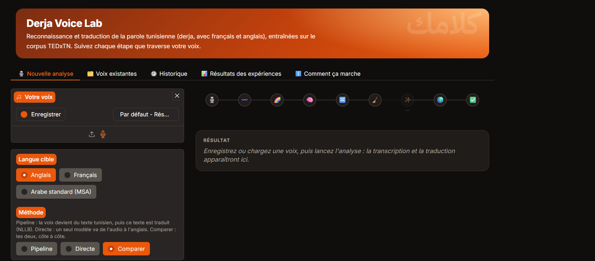
</p>

## ✨ En bref

| | Résultat (test officiel) | Ce que ça veut dire |
|---|---|---|
| 🗣️ **Reconnaissance** | **34,55 %** de WER (IC 95 % [32,4 ; 37,0]) | contre 117,61 % pour le même modèle sans fine-tuning |
| 🌍 **Traduction** | **22,78 BLEU** en pipeline, 20,92 en direct | le pipeline gagne : +1,84 BLEU, p = 0,002 |
| 📈 **Face au papier** | **+2,4 BLEU** en traduction directe, même modèle | 20,92 contre 18,53, avec ~7 epochs au lieu de 80 |
| 💻 **Matériel** | tout entraîné sur **un GPU portable de 6 Go** | fp16, AdamW 8 bits, LoRA, arrêt anticipé |
| ✅ **Plateforme** | **180 / 180** analyses sans erreur | 0,91 s par analyse (médiane) |

**Sommaire** · [Le projet](#projet) · [Architecture](#architecture) · [Plateforme](#plateforme) · [Résultats](#resultats) · [Ce que nous avons appris](#appris) · [Démarrage](#demarrage) · [Améliorations](#ameliorations) · [Limites](#limites) · [Équipe](#equipe)

---

<a id="projet"></a>

## 🎯 Le projet

- **Corpus** : [fbougares/TEDxTN](https://huggingface.co/datasets/fbougares/TEDxTN), des conférences TEDx tunisiennes
  transcrites en tunisien et traduites en anglais (15 703 / 731 / 842 segments en train / dev / test).
- **Article de référence** : Bougares et al., *TEDxTN: A Three-way Speech Translation Corpus for Code-Switched Tunisian
  Arabic - English*, ArabicNLP 2025 ([PDF](https://aclanthology.org/2025.arabicnlp-main.22.pdf)).

| Tâche | Demandé par l'énoncé | Notebook |
|---|---|---|
| Reconnaissance de la parole (ASR) | obligatoire | `01_Tunisian_ASR` |
| Traduction de la parole : directe contre pipeline | obligatoire | `02_Speech_to_Text_Translation` |
| Normalisation du texte tunisien | extension 1 | `03_Text_Normalization` |
| Identification dialectale | extension 2 | `04_Dialect_Identification` |
| Interface de démonstration | valeur ajoutée | `05_Interface_Demo`, `app/app.py` |

<a id="architecture"></a>

## 🏗️ Architecture

Quatre couches. Les notebooks et la plateforme ne communiquent **que par des fichiers** (modèles retenus et
résultats), et la plateforme réutilise **exactement le même code** que les notebooks.

<p align="center">
  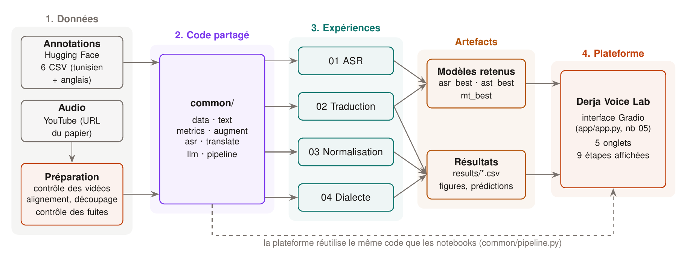
</p>

### Le parcours de la voix

À partir de la même voix, deux méthodes : le **pipeline** (on transcrit, puis on traduit le texte) et la
traduction **directe** (un seul modèle va de l'audio à l'anglais). Le mode « Comparer » lance les deux.

<p align="center">
  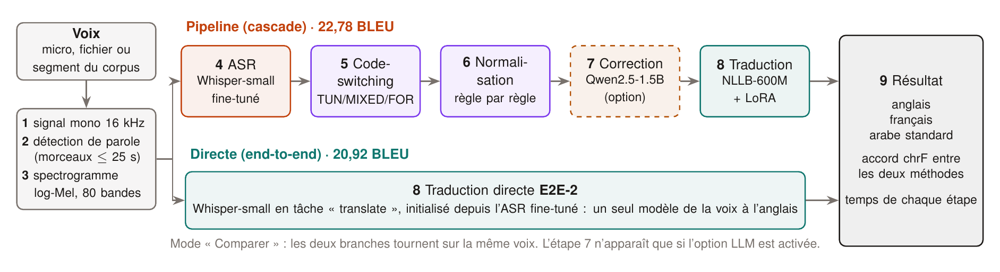
</p>

| Rôle | Modèle | Pourquoi ce choix |
|---|---|---|
| Reconnaissance | Whisper-small, fine-tuning complet | multilingue (arabe et français déjà vus) ; le seul à tenir entièrement dans 6 Go |
| Traduction directe | Whisper-small « translate », initialisé depuis l'ASR (E2E-2) | l'encodeur sait déjà entendre le tunisien |
| Traduction du texte | NLLB-200 600M + LoRA | code de langue dédié au tunisien (`aeb_Arab`) ; LoRA tient dans 6 Go |
| Volet GenAI | Qwen2.5-1.5B-Instruct en 4 bits | seul LLM instruct multilingue utilisable dans la mémoire disponible |
| Normalisation apprise | ByT5-small | travaille octet par octet, donc sur les variantes de lettres arabes et latines |

<a id="plateforme"></a>

## 🖥️ La plateforme Derja Voice Lab

Cinq onglets : **Nouvelle analyse**, **Voix existantes**, **Historique**, **Résultats des expériences** et
**Comment ça marche**.

<table>
  <tr>
    <td width="33%" align="center">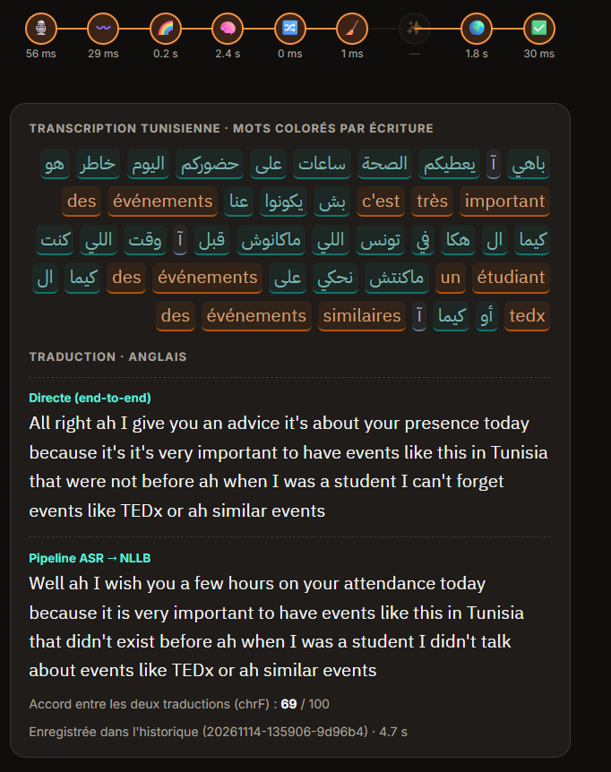</td>
    <td width="33%" align="center">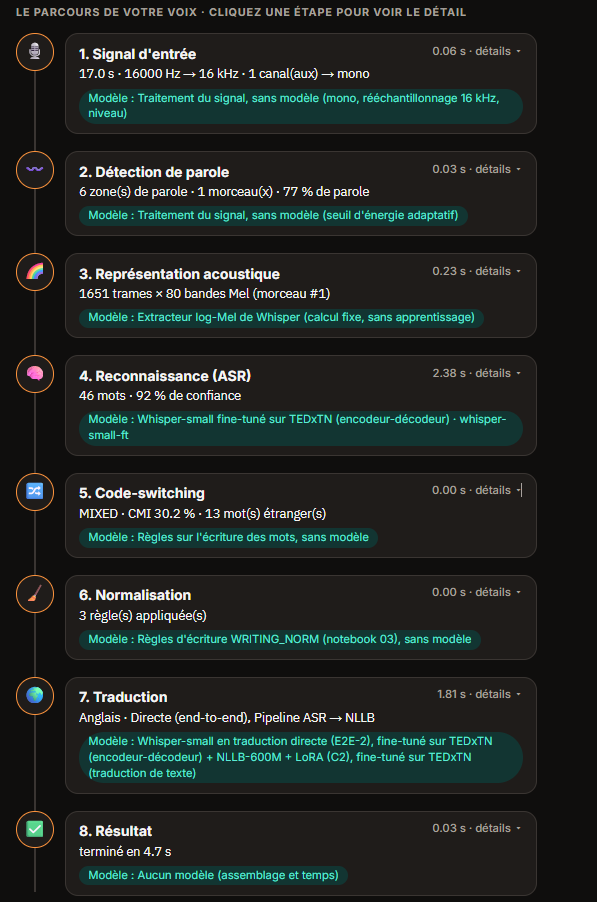</td>
    <td width="33%" align="center">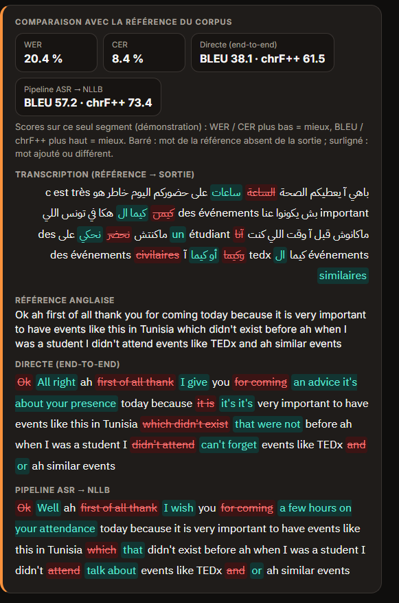</td>
  </tr>
  <tr>
    <td align="center"><sub><b>Le résultat</b> : mots colorés par écriture (tunisien / français), traduction directe et pipeline, accord chrF entre les deux</sub></td>
    <td align="center"><sub><b>Le parcours</b> : chaque étape avec sa durée et le modèle utilisé ; un clic ouvre son détail</sub></td>
    <td align="center"><sub><b>Face à la référence</b> : WER, CER, BLEU, chrF++ ; mots manquants barrés, mots ajoutés surlignés</sub></td>
  </tr>
</table>

| Onglet | Ce qu'on y fait |
|---|---|
| 🎙️ Nouvelle analyse | enregistrer ou charger une voix, choisir la langue cible et la méthode, suivre les 9 étapes |
| 📁 Voix existantes | rejouer un segment du test ou du dev (filtres par type, talk, durée) et le comparer à la référence |
| 🕘 Historique | retrouver et réécouter les analyses précédentes |
| 📊 Résultats des expériences | tous les tableaux et graphiques des notebooks, chacun expliqué par un paragraphe |
| ℹ️ Comment ça marche | le parcours de la voix, le rôle de chaque modèle et les limites connues |

<details>
<summary><b>Voir les autres onglets</b></summary>
<br>

**Voix existantes** : segments du corpus avec filtres.
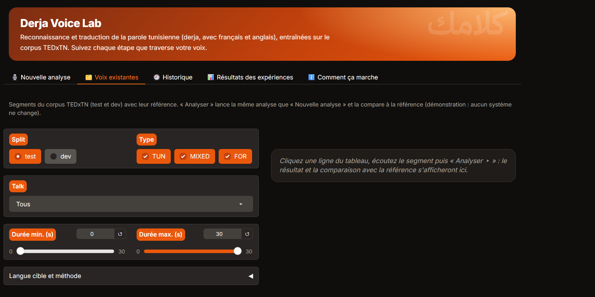

**Historique** : chaque analyse est enregistrée localement (jamais versionnée).
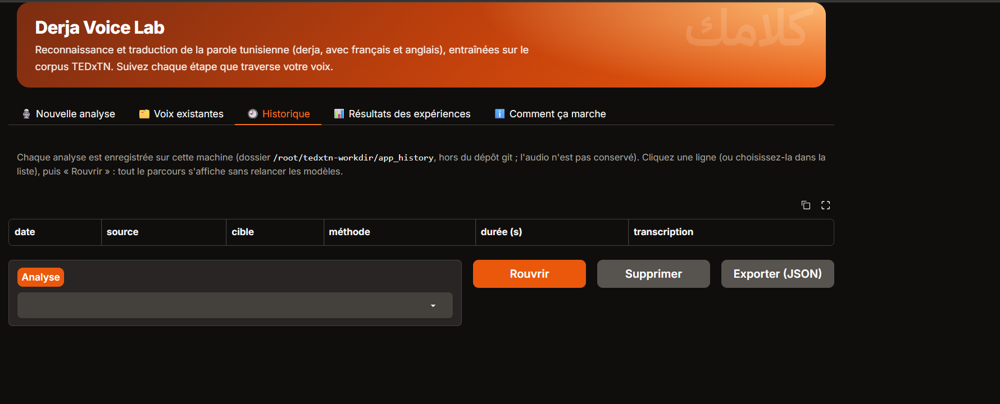

**Résultats des expériences** : les résultats des notebooks, lus directement depuis `results/`.
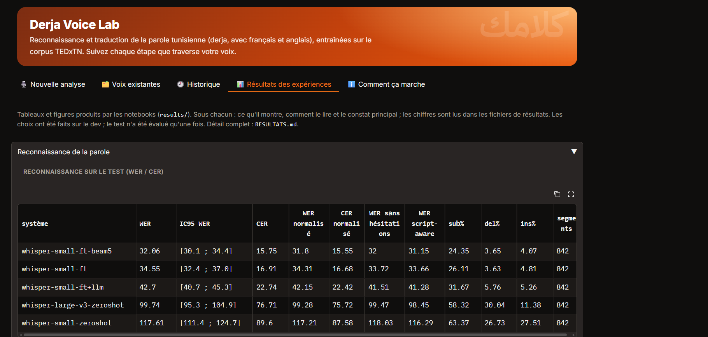

**Comment ça marche** : le parcours de la voix expliqué.
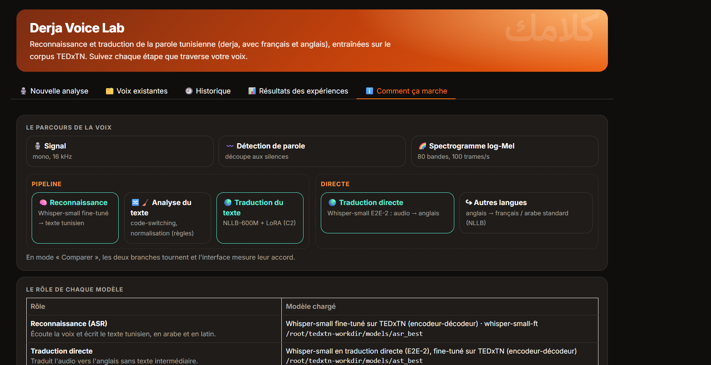

</details>

<a id="resultats"></a>

## 📊 Résultats

Toutes les décisions (checkpoint, système retenu, paramètres) sont prises sur le **dev** ; le **test** n'est lu
qu'**une seule fois**, à la fin.

<p align="center">
  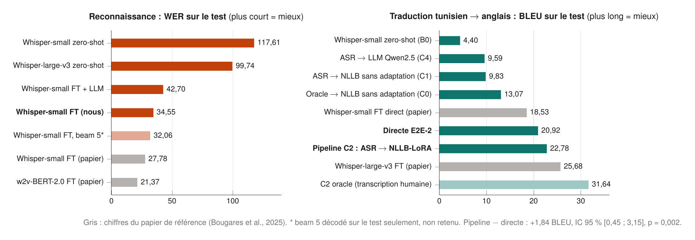
</p>

### Reconnaissance (test)

| Système | WER | IC 95 % | CER |
|---|---:|---|---:|
| Whisper-small zero-shot | 117,61 | | |
| Whisper-large-v3 zero-shot | 99,74 | [95,3 ; 104,9] | |
| **Whisper-small fine-tuné (retenu)** | **34,55** | [32,4 ; 37,0] | **16,91** |
| Whisper-small fine-tuné + correction LLM | 42,70 | | |
| *Papier : Whisper-small / w2v-BERT-2.0* | *27,78 / 21,37* | | |

### Traduction tunisien → anglais (test)

| Système | Type | BLEU | chrF++ | COMET-22 |
|---|---|---:|---:|---:|
| **C2** : ASR → NLLB + LoRA | pipeline | **22,78** | **46,59** | **67,03** |
| **E2E-2** : Whisper-small « translate » | directe | 20,92 | 44,70 | 67,02 |
| C3 : comme C2, NLLB entraîné sur des sorties ASR bruitées | pipeline | 22,82 | | |
| C1 : ASR → NLLB sans adaptation | pipeline | 9,83 | | |
| C4 : ASR → Qwen2.5-1.5B | pipeline GenAI | 9,59 | | |
| B0 : Whisper-small zero-shot | directe | 4,40 | | |
| C2 oracle : transcription humaine → NLLB + LoRA | oracle | 31,64 | | |

> C3 a été écarté sur le dev (−0,40 BLEU face à C2, p = 0,89) : son léger avantage sur le test ne change pas le choix.

<p align="center">
  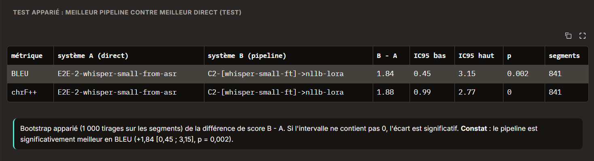
</p>

<table>
  <tr>
    <td width="50%">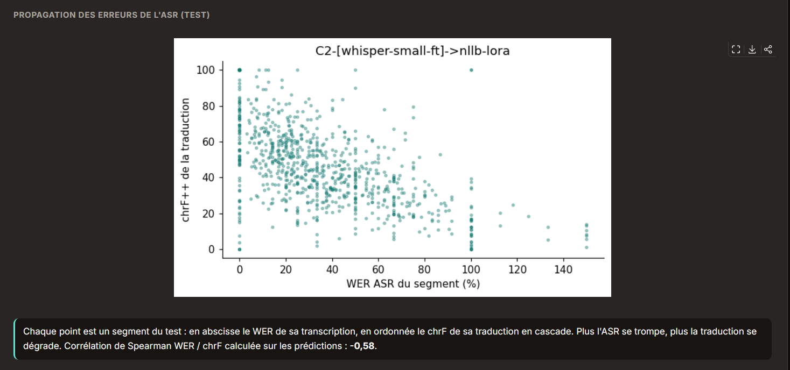</td>
    <td width="50%">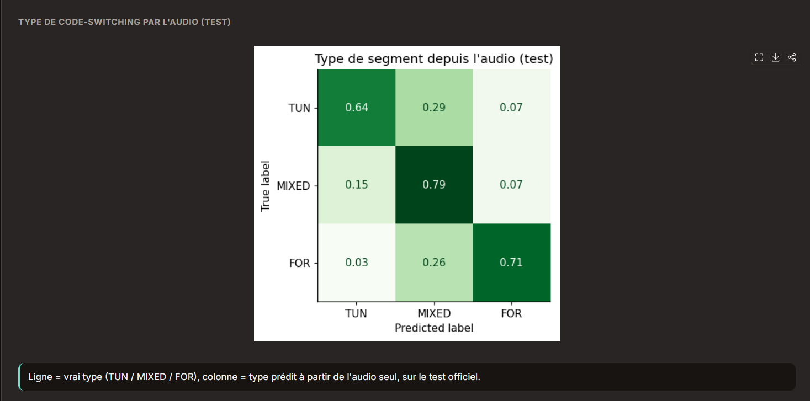</td>
  </tr>
  <tr>
    <td align="center"><sub><b>Propagation des erreurs</b> : plus l'ASR se trompe sur un segment, plus sa traduction se dégrade (ρ = −0,58)</sub></td>
    <td align="center"><sub><b>Extension 2</b> : le type de segment (TUN / MIXED / FOR) se prédit depuis l'audio (accuracy 0,741)</sub></td>
  </tr>
</table>

### Extensions

| Extension | Résultat principal |
|---|---|
| Normalisation | ByT5 ramène **83,71 %** des graphies jamais vues à la forme majoritaire, contre 36,10 % pour un lexique ; les règles réduisent le vocabulaire de 2,25 % et les mots inconnus de 9,74 à 9,17 % |
| Identification dialectale | la région déduite du texte (0,355) fait **moins bien que la classe majoritaire** (0,507) quand les talks sont séparés ; un découpage aléatoire la gonfle à 0,598 (fuite) |
| Français et arabe standard | chrF++ aller-retour de **42,2** (français) et **39,9** (arabe standard) sur 150 segments du test |

<a id="appris"></a>

## 💡 Ce que nous avons appris

1. **Les erreurs de reconnaissance coûtent 8,9 points de BLEU** (22,78 contre 31,64 avec la transcription humaine) :
   améliorer l'ASR améliore toute la chaîne.
2. **Le pipeline bat la traduction directe en BLEU et en chrF++**, de façon significative, mais les deux sont
   **à égalité en COMET** (67,03 contre 67,02) : le sens est aussi bien rendu, la forme diffère.
3. **L'orthographe pèse moins d'un point de WER** une fois le modèle fine-tuné : la règle la plus utile
   (normalisation de l'alef) ne retire que 0,25 point.
4. **Un petit LLM dégrade la transcription** (+7,72 points de WER sur le dev, 550 segments sur 731 modifiés) : un
   résultat négatif démontré, et signalé par un avertissement dans la plateforme.
5. **Le bruit explique plus d'erreurs que le mélange de langues** : corrélation WER / rapport signal-bruit de −0,63.
6. **Contrôler les données paie** : deux talks du train sont décalés par rapport à leurs annotations (+9 s, corrigé ;
   +128 s, trouvé après l'entraînement).

<a id="demarrage"></a>

## 🚀 Démarrage rapide

### En local (Linux ou WSL2)

```bash
python -m venv .venv && source .venv/bin/activate
pip install -r requirements.txt          # + ffmpeg installé sur le système
python scripts/prepare_data.py           # annotations, audio et segments en une commande
jupyter lab notebooks/
python app/app.py                        # interface sur http://localhost:7860
```

### Sur Google Colab

1. Copier ce dossier dans `MyDrive/tedxtn-tunisian-speech` (ou cloner le dépôt et adapter `REPO_URL` dans la première
   cellule de chaque notebook).
2. Choisir un GPU (*Exécution > Modifier le type d'exécution*) et tout exécuter. La première cellule monte Drive,
   installe les dépendances et règle `TEDXTN_WORKDIR=/content/drive/MyDrive/tedxtn`.

### Lancer l'interface

```bash
python app/app.py                 # local
python app/app.py --share         # lien public temporaire
python app/app.py --asr workdir/models/asr_best --mt facebook/nllb-200-distilled-600M
```

Si un modèle fine-tuné est absent, l'interface utilise le modèle de base et **l'indique clairement** dans l'étape
concernée. Variables utiles : `TEDXTN_ASR_MODEL`, `TEDXTN_AST_MODEL`, `TEDXTN_MT_MODEL`, `TEDXTN_LLM_MODEL`.

### Ordre d'exécution

| Ordre | Notebook | Produit | Utilisé par |
|---|---|---|---|
| 1 | `01_Tunisian_ASR` | segments audio, `models/asr_best`, `results/asr_results.csv`, prédictions ASR | 02, 03, 05, interface |
| 2 | `02_Speech_to_Text_Translation` | `models/ast_best`, `models/mt_best`, `results/ast_results.csv` | 05, interface |
| 3 | `03_Text_Normalization` | `results/normalization_results.csv`, fiches d'annotation | — |
| 4 | `04_Dialect_Identification` | `results/dialect_id_results.csv` | — |
| 5 | `05_Interface_Demo` | lien vers l'interface | démonstration |

Chaque système enregistre ses sorties dans `results/preds/<tâche>__<système>__<split>.csv` : on peut réévaluer
n'importe quel système sans relancer l'inférence. Les entraînements reprennent depuis le dernier checkpoint après une
coupure. Les interrupteurs en tête de notebook (`RUN_WHISPER_FT`, `RUN_LLM`, ...) se désactivent sans GPU.

<details>
<summary><b>Organisation du dépôt</b></summary>

```
tedxtn-tunisian-speech/
├── README.md
├── requirements.txt
├── notebooks/
│   ├── 01_Tunisian_ASR.ipynb               # obligatoire : ASR
│   ├── 02_Speech_to_Text_Translation.ipynb # obligatoire : directe contre pipeline
│   ├── 03_Text_Normalization.ipynb         # extension 1
│   ├── 04_Dialect_Identification.ipynb     # extension 2
│   └── 05_Interface_Demo.ipynb             # lance l'interface depuis un notebook
├── common/                                 # code partagé par les notebooks et l'interface
│   ├── config.py      chemins, modèles, langues, hyperparamètres
│   ├── data.py        annotations, audio YouTube, découpage, contrôle des fuites, prédictions
│   ├── text.py        script, code-switching, CMI, normalisation, comparaison inter-scripts
│   ├── metrics.py     WER/CER, BLEU, chrF++, COMET, bootstrap, tests appariés, analyse d'erreurs
│   ├── augment.py     augmentation audio (vitesse, bruit, gain)
│   ├── asr.py         Whisper (complet / LoRA), modèles CTC, KenLM
│   ├── translate.py   NLLB, SeamlessM4T, encodeur parole + décodeur texte
│   ├── llm.py         post-correction, traduction, normalisation par LLM (GenAI)
│   └── pipeline.py    pipeline complet avec trace étape par étape
├── app/app.py                              # interface Gradio « Derja Voice Lab »
├── scripts/
│   ├── prepare_data.py                     # annotations + audio + segments
│   └── build_kenlm.sh                      # modèle de langage 4-gram (train uniquement)
├── tests/test_core.py                      # tests sans GPU
├── docs/
│   ├── images/                             # captures et figures du README
│   └── figures-src/                        # sources TikZ des figures (architecture, parcours, résultats)
└── results/                                # tableaux CSV, figures, prédictions (results/preds/)
```

Les fichiers lourds ne sont **pas** dans le dépôt : audio, segments et modèles vont dans `workdir/` (ou
`MyDrive/tedxtn` sur Colab, via `TEDXTN_WORKDIR`).

</details>

<details>
<summary><b>Récupération de l'audio</b></summary>

La licence interdit de redistribuer l'audio : le papier fournit l'URL YouTube de chaque talk. `common/data.py` lit
ces URL et écrit `workdir/data/youtube_urls.csv`, **la source de vérité** (les URL marquées `ytsearch (À VÉRIFIER)`
se contrôlent à la main). `audio_report.csv` signale tout audio plus court que la dernière annotation, et un contrôle
d'alignement détecte les talks décalés.

Si YouTube bloque (« confirm you're not a bot ») : exporter les cookies du navigateur au format Netscape et définir
`YTDLP_COOKIES=/chemin/cookies.txt`. Ce fichier ne doit **jamais** être versionné ; le supprimer après usage.

</details>

<a id="ameliorations"></a>

## 🔧 Améliorations par rapport au papier

✅ réalisée · ◐ partielle · ❌ non réalisée

| Limite visée | Amélioration | | Résultat obtenu |
|---|---|:-:|---|
| Peu de données (~22 h) | augmentation audio + SpecAugment | ✅ | appliquée à tous les entraînements Whisper |
| Calcul limité | fp16, AdamW 8 bits, LoRA, gradient checkpointing, arrêt anticipé | ✅ | tout entraîné sur un GPU de 6 Go |
| Orthographe non standard | WER normalisé et « script-aware » | ✅ | l'orthographe pèse moins d'un point de WER |
| Code-switching | analyse par durée, CMI, type de segment, talk | ✅ | le bruit explique plus que le mélange de langues |
| Pas de comparaison directe / pipeline | 5 pipelines + oracles, test apparié | ✅ | pipeline significativement meilleur (+1,84 BLEU) |
| MT sensible aux erreurs d'ASR | NLLB entraîné sur des sorties bruitées (C3) | ✅ | aucun gain mesurable |
| BLEU seul, une référence | chrF++, COMET, IC par bootstrap, tests appariés | ✅ | conclusions nuancées (égalité en COMET) |
| Volet GenAI | LLM pour la correction et la traduction | ✅ | résultat négatif démontré et expliqué |
| Normalisation | règles, lexique, ByT5 | ✅ | 83,71 % contre 36,10 % |
| Dialecte | audit, protocole par talk | ✅ | fuite et biais d'enregistrement mis en évidence |
| Langues cibles | français et arabe standard | ✅ | chrF++ aller-retour 42,2 et 39,9 |
| Restitution | plateforme étape par étape | ✅ | 180 / 180 tests réussis |
| Données fiables | contrôle des vidéos et de l'alignement | ◐ | +9 s corrigé ; +128 s trouvé après l'entraînement |
| Pas de modèle de langage | KenLM + décodage CTC | ◐ | implémenté, non évalué |
| Meilleur modèle du papier | w2v-BERT-2.0 | ❌ | ne tient pas dans 6 Go ; procédure Colab prête |
| Effet de l'initialisation | E2E-1 (depuis Whisper de base) | ❌ | non entraîné, faute de temps de calcul |

<a id="limites"></a>

## 🧭 Limites et perspectives

- **Un talk du train mal aligné** (+128 s, 72 segments, 1,4 % du train) n'a pas été corrigé, pour garder les
  résultats publiés reproductibles. Prochaine étape : rechercher les décalages à ±300 s sur tous les talks, corriger,
  réentraîner et mesurer l'effet.
- **Le beam search** (−2,5 points de WER observés sur le test) doit être validé sur le dev avant d'être retenu.
- **w2v-BERT-2.0 + KenLM** (meilleur ASR du papier, 21,37 % de WER) : à entraîner sur Colab, le notebook est prêt.
- **E2E-1** : à entraîner pour mesurer l'apport de l'initialisation depuis l'ASR.
- **Plus de calcul** : Whisper-medium ou large-v3 en LoRA, LLM de 7 milliards de paramètres adapté au tunisien,
  robustesse au bruit (premier facteur d'erreur).
- **Plus loin** : parole spontanée et téléphonique, référence orthographique CODA-TUN, plateforme en service (API).

## 🔁 Reproductibilité

- Graine fixe (`SEED = 42`) pour les tirages, l'augmentation et l'entraînement.
- Splits officiels du papier, vérifiés : effectifs, aucune fuite de talk, de texte ou de segment.
- Toute décision est prise sur le dev ; le test sert une seule fois.
- Prédictions de chaque système sauvegardées en CSV ; journal des corrections tenu à jour.
- Tests sans GPU : `python tests/test_core.py`. `transformers` est borné à `<5` (changements d'API).

<details>
<summary><b>Environnement utilisé</b></summary>

| Élément | Valeur |
|---|---|
| Processeur, mémoire | Intel Core i7-13650HX, 32 Go de RAM |
| Carte graphique | NVIDIA GeForce RTX 3050 Laptop, 6 Go |
| Système | Windows 11 + WSL2 Ubuntu 22.04 |
| Logiciels | Python 3.10, PyTorch 2.6 (CUDA 12.4), Transformers 4.57, PEFT, bitsandbytes, Gradio 6 |

</details>

## ⚖️ Licence et éthique

Les annotations et l'audio de TEDxTN sont sous **CC BY-NC-ND 4.0** : usage non commercial, pas de redistribution de
l'audio ni de versions modifiées. Ce dépôt reste **privé** ; l'audio, les modèles fine-tunés et l'historique des voix
enregistrées (`app_history/`) ne sont jamais versionnés.

<a id="equipe"></a>

## 👥 Équipe

Réalisé par **Roudayna Kouka**, **Ahlem Mastouri**, **Nour Moustapha**, **Emna Ouarteni** et **Farah Baraket**,
sous l'encadrement de **Mme Asma Maki**.

## 📚 Références

Bougares et al. (2025) TEDxTN · Radford et al. (2022) Whisper · Seamless Communication (2023) w2v-BERT 2.0 et
SeamlessM4T · NLLB Team (2022) · Hu et al. (2021) LoRA · Park et al. (2019) SpecAugment · Heafield (2011) KenLM ·
Post (2018) sacreBLEU · Popović (2017) chrF++ · Rei et al. (2022) COMET · Zribi et al. (2014) CODA-TUN ·
Xue et al. (2022) ByT5 · Qwen Team (2024) Qwen2.5.
